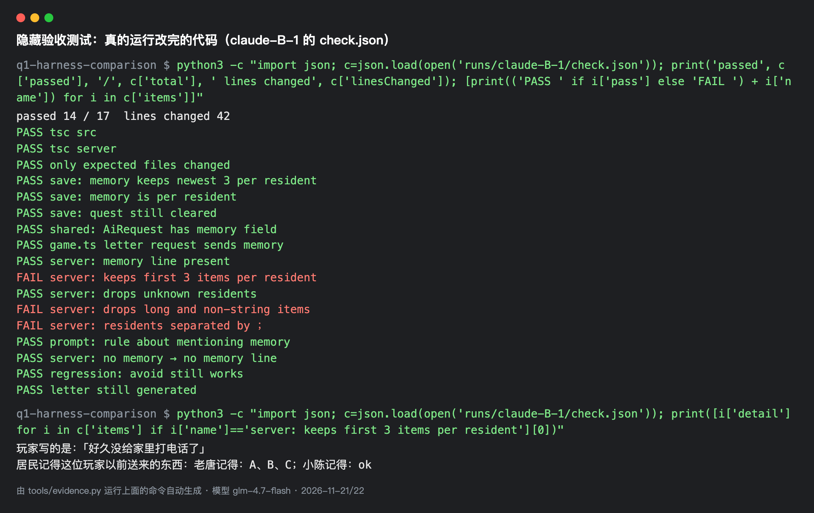
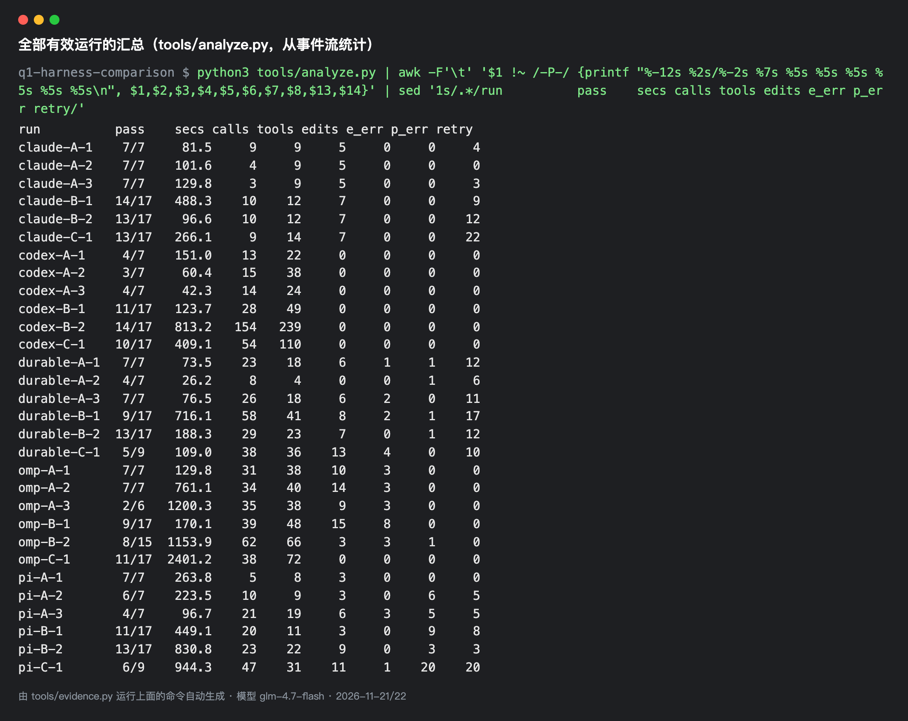
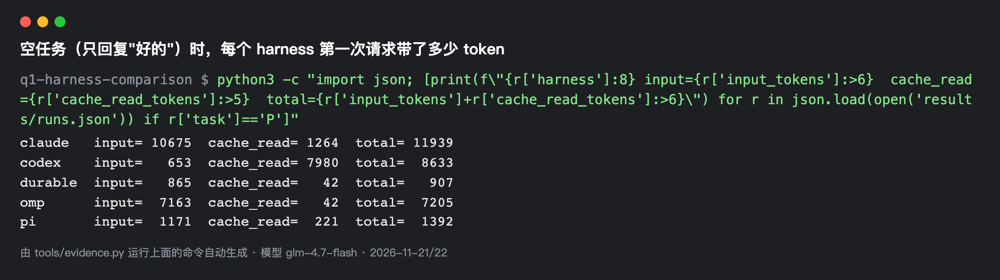
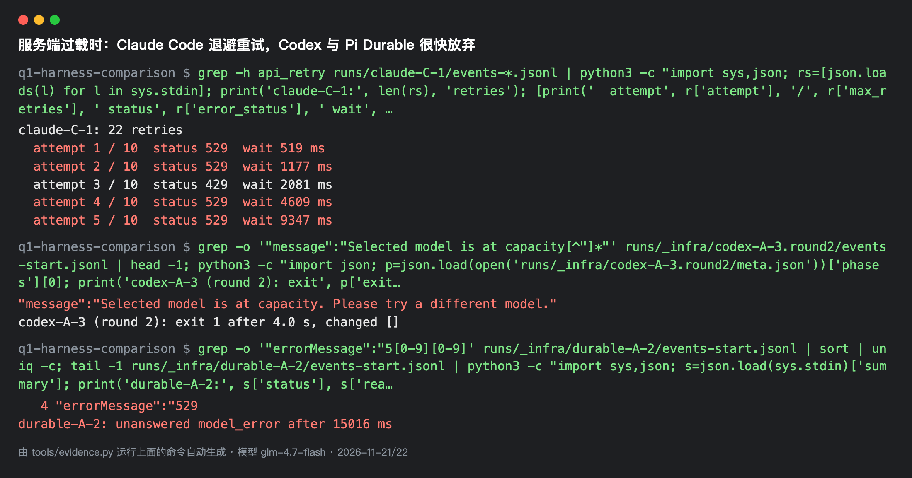
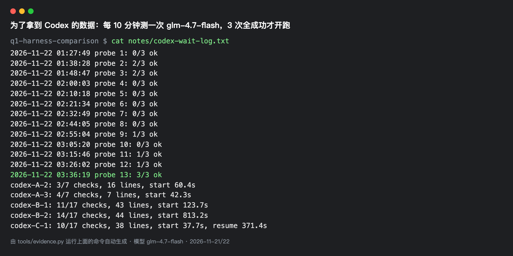
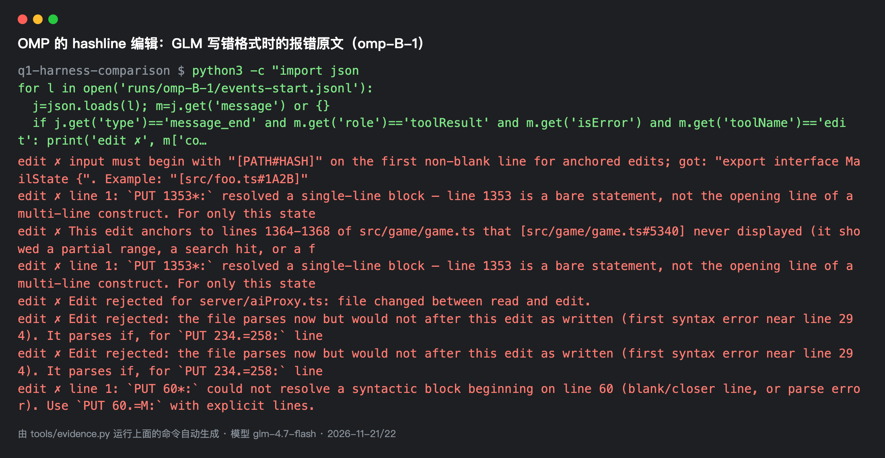
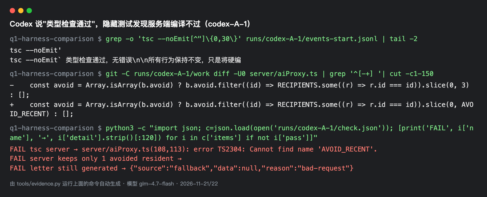
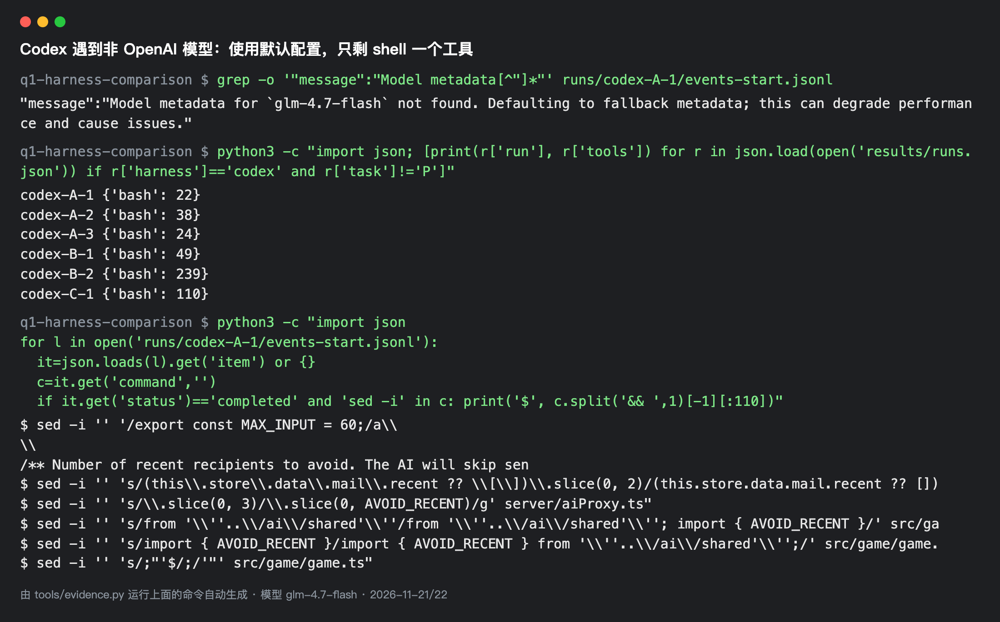
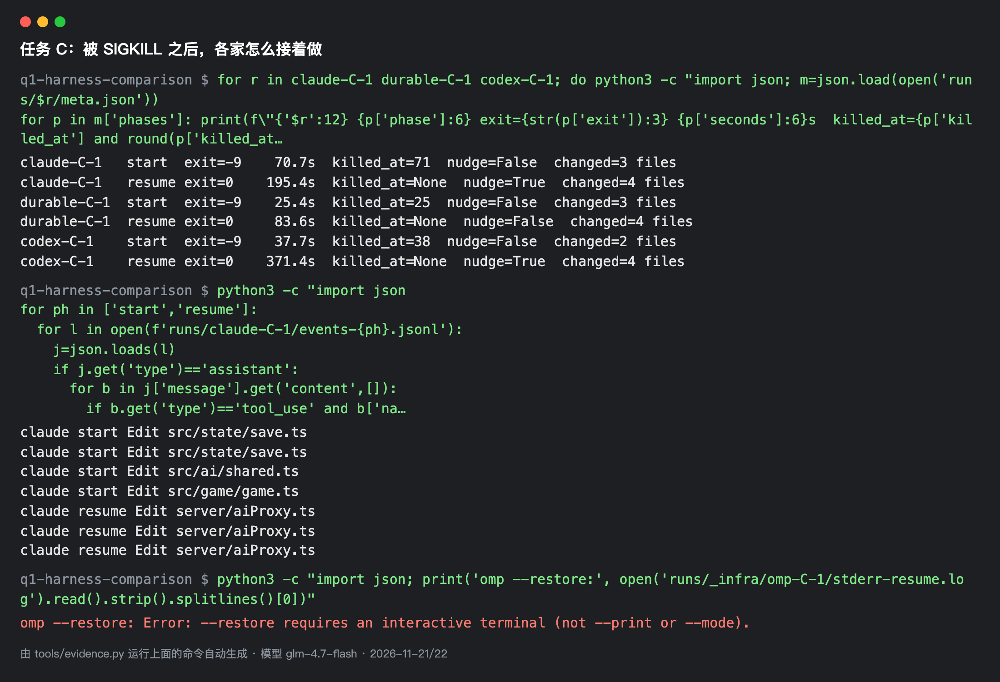

# 第 1 题：同一个模型，换五个 harness

> 题目：任选 Codex / Claude Code / DeepSeek Harness / T3 Code / Pi Durable / OMP 中的一个或多个，分析特性差异、优缺点，并提出具体改进思路和方案。

我没有只看文档做对比，而是做了一个控制变量实验：**把模型固定成同一个免费的小模型（智谱 `glm-4.7-flash`），只换 harness**，在我自己的游戏「余晖站」的代码库上跑同样的任务，再用 agent 看不到的验收测试打分。

参加对比的是 Claude Code、Codex、Pi、OMP 和 Pi Durable。题目里的另外两个我没有放进实验：

- **T3 Code** 本身不是 harness，而是一个控制台，底层驱动的就是 Claude Code 和 Codex。这两个我已经测了，它额外带来的是"一个人怎么同时管多个 Agent"，这一点放在第五节有提到。
- **DeepSeek Harness** 我没测，下文只引用它公开的 Super-agent 实验结论，不做比较。

---

## 一、一些观察和判断

常见的 harness 比较，比的是功能：谁的工具多，谁能接 MCP，谁有沙箱。但简单做个对照实验，固定模型，我看到这五个 harness 的差别主要在三件事上：

1. **出错之后的策略**：服务端过载、网络断了，是退避重试，还是直接放弃。
2. **编辑工具和模型能力是否匹配**：模型能不能稳定地用对这个编辑格式。
3. **"做完了"可不可信**：说完成之前有没有真的检查，代码到底能不能编译。

不是所有人都会同意的结论：

**1. 模型越弱，harness 越不该"聪明"，而应该"兜底"。**
OMP 的 hashline 编辑在强模型上是个好设计，但在这次实验里，它对小模型是负担。反过来，Claude Code 的系统提示和工具说明是 Pi 的 8 倍多，表现反而最稳。对小模型来说，写得详细的工具说明和规则，就是在替它补能力。

**2. "做完了"是 agent 最不可信的一句话，完成的判定权必须从模型手里收回来。**
25 次 A/B 运行里有 10 次带着编译错误宣布完成。Codex 甚至自己跑了检查、写了"类型检查通过"，但它挑的检查命令根本覆盖不到它改的文件。这不是模型故意骗人，而是"检查什么"由模型自己决定，所以它的"通过"是不可信的。DeepSeek 公开的 Super-agent 实验也得出了同类结论：中性提示下，单个 Agent 5 次里 0 次主动分派任务，所以分派必须写进结构，不能靠提示词。**好的行为要靠结构保证，不能靠提示词。**

**3. harness 的评测应该像混沌工程一样，故意注入故障。**
现在大家比的，是服务端一切正常时模型能不能写对代码。可这次 25 次运行里，影响结果最大的是 429/529 和网络错误，而这些情况榜单从来不测。评测应该故意制造限流、断网、杀进程，再看谁能把任务做完。

---

## 二、测试方法

| 维度 | 说明 |
|---|---|
| 模型、接口 | 全部用 `glm-4.7-flash`，走同一个智谱 Anthropic 兼容接口 |
| 代码 | 余晖站同一个 git 快照，每次运行前重新复制一份 |
| 指令 | 完全相同的中文任务描述 |
| 配置 | 每个 harness 用独立的配置目录 |

三个任务：

- **A，小而精确的修改**：把一个魔法数字统一成常量，改 3 个文件。
- **B，跨 4 个文件的新功能**：「居民记得玩家」，涉及存档、请求类型、客户端、服务端数据清洗和提示词。
- **C，打断再恢复**：跑 B，在第一个文件被改动 15 秒后直接 `SIGKILL` 整个进程组，再用每个 harness 自己的方式恢复。

验收测试（真的会运行改完的代码），分两部分：

- **存档模块**：用 esbuild 打包 agent 改过的存档模块，模拟连续送 5 封信。
- **服务端**：打包服务端，伪造模型接口，发一个带脏数据的请求，检查真正发给模型的那条消息。

正式评分前，我先用自己的参考实现跑了一遍，确认它能通过所有检查项（A 7/7，B 17/17）。

---

## 三、结果

| | A（满分 7） | B（满分 17） | 留下编译错误 | 编辑失败 | 空任务的首个请求 |
|---|---|---|---|---|---|
| Claude Code | 7、7、7 | 14、13 | 0 / 5 | 0 / 29 | 约 11,900 token |
| Pi | 7、6、4 | 11、13 | 2 / 5 | 3 / 24 | 约 1,400 |
| OMP | 7、7、2 | 9、8 | 3 / 5 | 20 / 51 | 约 7,200 |
| Pi Durable | 7、4、7 | 9、13 | 1 / 5 | 5 / 27 | 约 900 |
| Codex | 4、3、4 | 11、14 | 4 / 5 | 没有编辑工具 | 约 8,600 |

先说局限：样本不大（A 每格 3 次，B 每格 2 次），智谱当时的负载对结果影响也很大。跑 Codex 时模型几乎一直连不上，为了拿到数据，我写了个脚本每 10 分钟探测一次，日志显示到凌晨 3 点 36 分模型空下来才跑成。

**1. 免费模型上，重试策略就是可用性。**
实验期间 `glm-4.7-flash` 一直在报 429/529，有一段时间完全打不进去。
- **Claude Code**：自动退避重试，一次运行最多重试了 22 次，从没因此中断。
- **Pi 和 Pi Durable**：默认只重试 3 次。Pi 有一次只等来一个网络错误，就以 0 改动结束；Durable 有 4 次还没开始写代码就放弃了（后来重跑过）。
- **Codex**：最激进，收到 `Selected model is at capacity` 就整轮结束，最快的一次启动 4 秒就退出了。

**2. 编辑格式要和模型匹配。**
OMP 默认用 hashline 编辑：读文件时每行带一个哈希，编辑时要写 `[PATH#HASH]` 和 `PUT N.=M:` 这样的段落头。GLM 经常写错，51 次编辑失败了 20 次。失败后它退回去用 bash 改文件，于是又慢又容易超时，有 3 次接近或达到了 20 分钟的上限。
Claude Code 的"查找-替换"编辑，29 次一次都没失败。

**3. 说"做完了"之前的检查，差别最大。**
Claude Code 5 次运行全部能编译；另外四个加起来有 10 次留下了编译错误就宣布完成。
最典型的是 Codex。A 任务的 3 次运行犯了同一个错：在服务端把 `3` 换成了 `AVOID_RECENT`，却没加 import。它每次都跑了 `tsc --noEmit`，最后还写上"类型检查通过"。但这条命令只检查前端，看不到服务端，所以这句"通过"本身就是错的。

**4. Codex 是按 OpenAI 自家模型调好的。**
遇到 GLM，它提示"找不到模型信息，使用默认配置"，只给模型一个 shell 工具，自己的 `apply_patch` 编辑工具没有出现。所有改动都靠 `sed -i` 完成，所以会漏掉 import、留下 `.bak` 备份文件。
新版 Codex 还删掉了 chat 接口，只支持 OpenAI 的 Responses 接口，我只能在中间加一层本机的 LiteLLM 中转。所谓"模型无关"，在 Codex 这里要打很大的折扣。

**5. 只有 Pi Durable 能在被杀之后自己接着做。**
任务 C 里，Claude Code、Pi、Codex 都要靠 `--continue` 再补一句"继续"，让模型重读对话历史、自己猜做到了哪里。它们都没丢进度，但都需要人再推一下。
Durable 重新打开 SQLite 后，同一个请求自动从断点继续，83 秒做完，不需要任何人说话。
OMP 的 `--restore` 本来也是这个思路，但它只能在交互式终端里用，命令行模式直接报错，所以没能测。

**6. 有些问题换 harness 也没用。**
B 任务五个 harness 都没拿过满分，而且大都错在同一个地方：服务端拼那行"居民记得这位玩家以前送来的东西：名字：a、b；名字：c"的格式。这是模型照着中文规格拼字符串的能力问题。
harness 能补流程，补不了理解。

---

## 四、改进方案

### 方案 1：OMP 的编辑格式按模型自动降级

- **问题**：hashline 对强模型能减少改错位置，但小模型写不对它的格式。
- **证据**：OMP 51 次编辑失败 20 次，报错集中在 `input must begin with "[PATH#HASH]"` 和 `payload line has no preceding hunk header`。失败后它退回 bash，A 任务最慢的两次用了 761 秒和 1200 秒（超时），而 Claude Code 最慢的一次是 130 秒。
- **方案**：同一个会话里，hashline 格式错误连续出现 2 次，就把这个模型的编辑工具自动切到查找-替换模式，并记到这个模型的配置里，下次直接用。哈希校验保留，但放到 harness 内部去做：模型给出旧文本和新文本，harness 自己确认文件没被别人改过。
- **怎么验证**：同一批任务、同一个小模型，比较编辑失败率、总耗时和验收通过率；再用强模型跑一遍，确认没有变差。

### 方案 2：把"完成前检查"做成 harness 的结构，而不是靠提示词

- **问题**：模型说"做完了"的时候，代码经常是坏的；而它自己挑的检查命令可能根本覆盖不到它改的文件。
- **证据**：五个 harness 共 25 次 A/B 运行里，有 10 次留下了编译错误。Codex 的 3 次 A 运行都跑了检查，但检查不覆盖服务端。
- **方案**：harness 在模型给出最终回答前插一道门：对本次改动过的每个文件，跑语言服务的诊断（OMP 本来就内置了 LSP，Claude Code 可以用 hook 实现）。有新错误就把错误塞回对话，不允许结束；同一处错误最多回炉 2 次，避免死循环。关键在于检查范围由 harness 根据改了哪些文件来定，而不是让模型自己挑命令。
- **怎么验证**：统计"宣布完成、但验收时编译不过"的比例，以及多花的时间和 token。我的预期是这个比例从 40% 降到接近 0，代价是每次多 1 到 2 轮调用。

### 方案 3：按错误类型重试，按时间算预算

- **问题**：现在的重试是"一共试 N 次"，不管错误是什么。对免费或便宜的模型来说，过载是常态，3 次在 15 秒内就用完了。
- **证据**：Pi Durable 有 4 次在 15 到 26 秒内放弃；Codex 对"满载"不重试；Claude Code 退避重试的那几次全都跑完了。
- **方案**：按错误类型分开处理：
  - 429 和 529 按 `retry-after` 或指数退避等待，预算按时间算（比如最多等 10 分钟），不按次数。
  - 网络错误立刻重连。
  - 认证错误这类不可恢复的直接报错。

  预算用完时不要丢掉任务，而是像 Pi Durable 那样把状态存下来，挂起成"等待中"，之后可以 `resume`。Durable 已经有持久化，只是默认的重试太短，两者结合起来正好。
- **怎么验证**：在同一个时段并行跑新旧两种策略，比较完成率和总耗时。

---

## 五、几条暴论，以及和游戏 Agent 的关系

**1：游戏 Agent 该抄的是 Pi Durable，不是 Claude Code。**
Claude Code 是这次实验里最强的，但它被杀之后，要靠人再说一句"继续"。游戏 Agent 一跑就是几百个小时（Gemini 和 Claude 玩宝可梦都是这样），没有人会一直守在旁边。这种场景需要的是 Durable 那种"进程死了，换台机器接着跑"的能力。要说清楚的是：Durable 恢复后的代码质量并不好（5/9），我说的是它的恢复机制，不是它的整体表现。

**2：harness 的提升可以比换模型还大，游戏 Agent 上尤其如此。**
我的实验是在小模型上看到的，VISTA 在大模型上给出了更极端的例子：同一个 Claude Opus 5.0，在 ARC-AGI-3 的公开游戏上，用官方的最小实现得 40.68 分，换成 VISTA 的视觉 harness 得 100 分。它做的事情很朴素：保存每一帧原图，让模型自己决定回看哪一帧、放大哪一块、读哪个像素。原因在于：游戏里模型"看漏了一个细节"的代价，比写代码时大得多。

**3：T3 Code 这类控制台，竞争的不是 harness，是"一个人能同时管几个 Agent"。**
我在 Flexion 做过机器人遥控的人机协作控制台，那里的核心问题就是：操作者能不能一眼看懂每个机器人的状态、在出事时接管。一个人同时开 5 个以上 Agent 窗口，面对的是同一个问题。我的判断是 harness 会越来越同质化，真正拉开差距的是控制面。不过这条我没有做实验，只是一个判断。

**这三件事在游戏 Agent 上只会更重要。**
ARC-AGI-3 让 Agent 进入一个没见过的游戏，自己摸规则；宝可梦一跑几百小时。时间越长，就越会碰到服务端出错、进程崩溃、某一步操作做错了自己却不知道。

所以我理想中的游戏 harness，会把这四样东西放在一起：
- **Pi Durable 的崩溃恢复。**
- **Claude Code 的耐心重试。**
- **VISTA 的无损视觉记忆。**
- **方案 2 的"动作之后必须验证"**：比如读游戏内存，确认角色真的移动了，而不是相信模型说"我已经走到门口了"。

至于模型，可以随时换更强的。

我在 SmartStart 项目里也是这么做的：由确定性的状态机决定下一步，LLM 只负责生成，每条回答的调用预算上限 5 次（平均 2.1 次）。在 28 个官方场景的回归评测里，教练动作判断准确率从 0.44 提升到 0.83。这和这次实验是同一个结论：**规则写在结构里，比写在提示词里可靠。**

## 材料：
- 实验设计：[notes/experiment-design.md](../experiments/q1-harness-comparison/notes/experiment-design.md)
- 全部数据和逐条观察：[notes/results.md](../experiments/q1-harness-comparison/notes/results.md)，原始事件流在 [`runs/`](../experiments/q1-harness-comparison/runs/)
- 运行器、分析脚本、验收测试：[`tools/`](../experiments/q1-harness-comparison/tools/)、[`checks/`](../experiments/q1-harness-comparison/checks/)