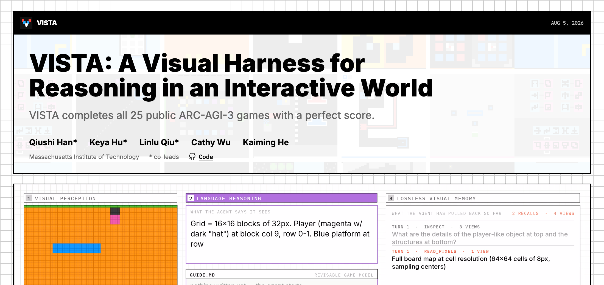
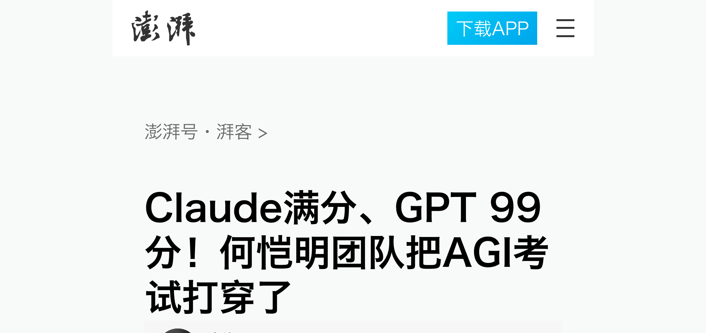
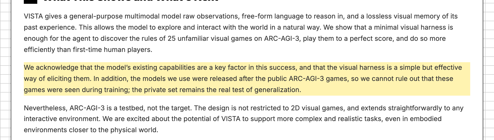
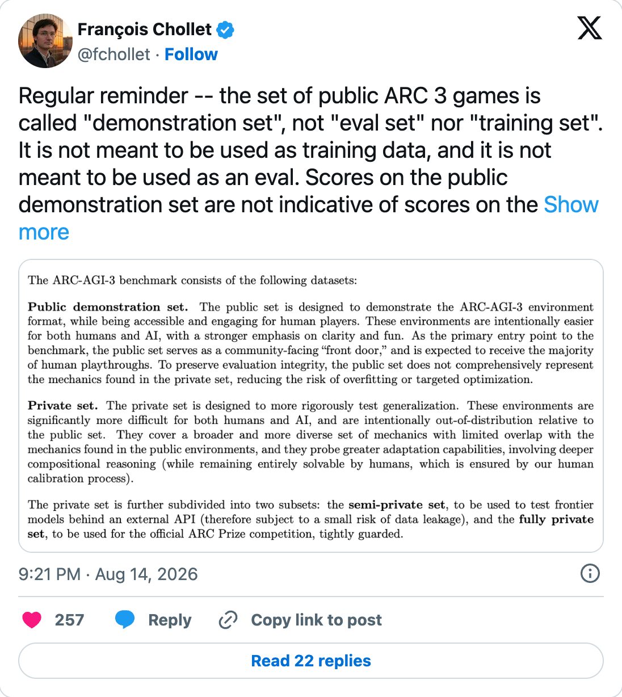

# 第 3 题：如果我是 VISTA 的传播负责人

> 题目：任选 SSI、VISTA Harness（何恺明团队）、DeepSeek Harness 的 Super Agent。如果你是传播负责人：应该吸引怎样的人？做什么内容？由哪些 KOL / KOC 传播？怎样设计发布节奏？

**我选 VISTA**，原因有两个：
1. 它是"AI 玩游戏"，和这个岗位比较近。
2. 它已经发布了三个多月，可以拿真实发生的传播来复盘，而不是凭空写一份方案。

另外两个不选，也是因为传播目标太特殊。SSI 没有产品，它的传播几乎只为了招最顶尖的几十个人；Super Agent 是开发者工具的冷启动。VISTA 正好在中间：它既要学术圈认可，又天然能破圈。

下面的事实我都核对过原始来源（项目主页、arXiv、GitHub、X 原帖），截图都是对真实页面截取的，来源列在文末。

---

## 一、先说我的判断

**VISTA 最响亮的那句话，也是它最大的传播风险：「满分」。**

项目主页第一行写着"25 个公开游戏全部满分"，中文媒体的标题是"把 AGI 考试打穿了"：

但同一个主页的最后一节，作者自己写了一段限定：所用模型发布于公开游戏之后，不能排除训练时见过这些游戏，**私有集才是真正的泛化检验**。

ARC-AGI 的作者 Chollet 在 8 月 14 日发了一条"例行提醒"，大意是公开游戏是"演示集"，不是评测集，它上面的分数不代表真实成绩。这条推文没有点名任何人，但它发在 VISTA 博客发布后的第 9 天。ARC Prize 的技术报告也写明，公开集上的分数永远不会上官方榜单。

所以现在的局面是：**限定条件写在页面最底下，媒体只抄了第一行。** 短期热度很高，但它把一篇本来很扎实的研究，放在了"一戳就破"的位置上。只要私有集的成绩不是满分，第二波传播就会变成"何恺明团队的满分被打脸"。

如果我负责传播，我会**主动给"满分"降调**，把核心信息从"满分"换成"只换 harness"：

> **同一个模型，不训练，只换一个会"看"的 harness，ARC-AGI-3 从 40 分到 100 分。**

这句话保留了反差和数字，又把功劳放在了 VISTA 真正贡献的地方：harness。即使私有集分数低一些，这句话依然成立，因为"同一个模型换 harness 涨了多少"在私有集上也可以重新测。

（这也是我在第 1 题里做的事：把模型固定住，只换 harness。VISTA 是这个思路最漂亮的一个例子。）

---

## 二、目标和受众

VISTA 不卖产品，所以传播目标不是"用户数"，而是三件事，按重要性排序：

1. **让 harness 这个思路被采用**：别的团队在自己的 Agent 里用"无损视觉记忆 + 主动回看"。衡量指标是复现和移植的数量。
2. **学术影响**：引用、后续工作。
3. **团队声誉**：招学生、拿资源。

| 受众 | 他们想要什么 | 给他们什么 |
|---|---|---|
| ARC 社区和多模态研究员（核心） | 这结果靠不靠谱，能不能复现 | 代码、完整轨迹、私有集计划 |
| Agent / harness 工程师（扩散） | 我能不能把这套东西搬进自己的 Agent | 一页"怎么移植"的说明，三个工具的接口 |
| 对"AI 玩游戏"好奇的人（破圈） | 好不好看 | 回放：AI 怎么卡住、怎么回看、怎么突然想通 |

---

## 三、做什么内容

**1. 回放是最被低估的资产。**
项目主页其实已经给每个游戏都放了一个完整回放，能看到模型每一步看到了什么、写了什么笔记、回看了哪一帧。但它们埋在页面中段，每个只是一个"View replay"链接。这正是 B 站和抖音最想要的素材：AI 卡住、回看、突然想通。B 站上"AI 玩 MC"的视频动辄几百万上千万播放（见第 4 题），说明观众要看的就是这种过程。我会挑 3 个最有戏剧性的游戏，剪成 30 秒竖屏视频和 3 分钟的 B 站视频。

**2. 一张消融阶梯图。**
同一个模型，换输入方式和工具，分数一步一步涨上去。比如 GPT-5.6 Sol 只是把数字表换成图片，就从 13.33 涨到 47.32。研究员最爱转这种图，因为它把"每个设计贡献了多少"讲清楚了。

**3. 一篇"怎么搬进你的 Agent"的短文。**
VISTA 的思路其实很朴素：保存每一帧原图、让模型自己决定回看哪一帧、能读精确像素。社区已经有人自发把它移植到 DeepSeek Harness 上了：GitHub 上有两个移植仓库，官方仓库也收到过加 DeepSeek 后端的 PR。官方应该写一篇移植指南，把这些自发的 KOC 接住，而不是让他们各自摸索。

**4. 主动发"我们还没证明的东西"。**
把主页最后那段限定提到最前面，做成单独一条推文：我们哪些没测、私有集打算怎么测。在 AI 圈，**坦诚本身就是可信度**，而且它能提前拆掉最大的那颗雷。

---

## 四、由谁传播

| 节点 | 为什么是他们 | 怎么合作 |
|---|---|---|
| **ARC Prize 团队**（Chollet、Knoop） | 基准作者的一句话，比任何媒体都有分量；同时也是最可能公开质疑的人（8 月那条推文就是证明） | 不是请他们转发，而是**请他们在私有集上跑一次**。无论结果如何，都是一次可信的第二波传播 |
| 做"AI 玩宝可梦"的人（Gemini / Claude Plays Pokémon 的开发者） | 他们最懂长程游戏 Agent 的视觉记忆有多难，评价最内行 | 请他们试着把 VISTA 的回看工具接进自己的 harness |
| 论文推送号（如 AK）、中文 AI 媒体 | 覆盖面 | 提供统一口径的一句话和图，避免"打穿了"这种标题 |
| **KOC：移植 VISTA 的开发者** | 真实复现最能证明"思路可以迁移" | 官方 README 里列出社区移植，在推特上转发他们 |
| B 站、YouTube 的游戏区 UP 主 | 破圈 | 给他们回放素材，做"人类 vs AI 第一次玩同一个游戏"的对比 |

---

## 五、节奏：实际发生的 vs 我会怎么做

| 时间 | 实际发生的 | 我会改的 |
|---|---|---|
| 8 月 5 日 | 项目主页发布（博客版） | 同一天发 30 秒回放视频；限定条件放在第一屏 |
| 8 月 14 日 | Chollet 发推提醒"公开集分数不算数"（未点名） | 在这之前，主动和 ARC 团队沟通私有集评测 |
| 9 月 5 日 | 代码开源（到 11 月 22 日约 640 star、43 fork） | 和主页同一天开源。晚了一个月，第一波热度已经过了 |
| 10 月 1 日 | arXiv 论文 | 同时公布私有集评测计划 |
| 10 月 4～10 日 | 中文媒体集中报道，标题强调"满分""打穿" | 提前给媒体统一口径："只换 harness，从 40 到 100" |
| 10 月～11 月 | 社区移植到 DeepSeek Harness；有后续论文讨论 ARC-AGI-3 是感知问题还是规划问题 | 主动转发、收录这些工作；和 ARC 团队做一次对谈 |
| 之后 | — | 发布私有集成绩；换一个非 ARC 的游戏环境再跑一次，证明"ARC 只是测试场" |

有一个小细节：主页写的是"比首次游玩的人类少用 56.0% 的步数"，论文摘要是 57.4%。版本之间数字变了很正常，但传播时应该只用一个数，否则会被杠精拿来做文章，当然了黑红也是红，知识不太适合这类带有学术性的。

---

## 六、要提前准备的质疑

| 质疑 | 回应 |
|---|---|
| "公开游戏可能在训练数据里" | 作者自己已经承认。传播上要做的是把它放在最前面，并给出私有集的时间表 |
| "满分是模型强，不是 harness 强" | 用同一个模型的消融数据回答：只换 harness，分数涨了多少 |
| "每个游戏花了多少钱、多少时间" | 公开 token 和耗时。不公开的话，这会是下一个被追问的点 |

---

## 七、怎么判断传播成功，以及我自己的经验

不看阅读量，看三个数字：
1. **社区移植和复现的数量**（GitHub 上搜得到的）。
2. **别人转述时用的是哪句话**：是"满分"，还是"只换 harness"。前者说明传播跑偏了。
3. **私有集结果出来那周的舆论**：是"果然不行"，还是"他们早就说过"。

这个判断来自我自己做推广的经验。我在苏黎世学联做宣传，每年 40 多场活动，也在创业时做过海外的双语内容。无论在海外还是国内，让人参与最直接的办法往往是给补贴。但这种参与是一次性的，能完成甲方要的数字，却留不住人。真正带着目的来的参与者，最想听到的是真诚的回答。所以**主动暴露一些真实的问题，反而是留住高粘性参与者最好的方法**。

VISTA 也是一样。追着"满分"来的读者，私有集一出来就会走；被"只换 harness"和"我们还没证明什么"吸引来的研究员和工程师，才会去复现、去移植。开源在这里也很关键：社区能自己动手，初期的问题就会解决得更快。

---

## 来源

- VISTA 项目主页：https://vista-research.github.io/
- 论文：https://arxiv.org/abs/2610.02200
- 代码：https://github.com/joshhhhhan/VISTA（star、fork、提交时间用 `gh api repos/joshhhhhan/VISTA` 查得，2026-11-22）
- 澎湃转载的报道：https://m.thepaper.cn/newsDetail_forward_34204446
- Chollet 关于公开演示集的推文（2026-08-14）：https://x.com/fchollet/status/2088254592182305165
- ARC-AGI-3 技术报告：https://arcprize.org/media/ARC_AGI_3_Technical_Report.pdf
- 后续讨论 ARC-AGI-3 的论文：https://arxiv.org/abs/2611.06793
