# 第 4 题：各平台 × 各载体的内容范式

> 题目：在 X、小红书、即刻、抖音 / B 站等平台，制作不同载体的内容（图文 / 视频 / 短文字 / 长文博客），最佳范式分别是什么？给出你觉得做得非常好的具体例子（附链接或截图），以及你总结的方法论。

---

## 一、一些我的判断

**1. 平台的用户喜好、使用逻辑是不同的**

同一份素材里有很多种：一个数字、一张截图、一次翻车、一段过程、一套能复现的方法。每个平台的用户只愿意为其中一种停下来：

| 平台 | 先给什么 | 为什么 |
|---|---|---|
| X | **一个反常识的观点或新词** | 用户在刷"聪明人怎么看"。一句话就是一个观点，最容易被引用、转发 |
| 小红书 | **一张能看懂结果的图** | 用户在找"我能照着做的东西"。封面就是结果，收藏比点赞重要 |
| 即刻 | **一个踩过的坑** | 用户想看真实的人在干什么。过程和失败比结论更可信 |
| 抖音 | **一个瞬间** | 3 秒内必须有冲突，一个视频只讲一件事 |
| B 站 | **整个过程** | 用户愿意花 20 分钟，但要看到完整的来龙去脉，最好能在弹幕里吵起来 |
| 长文博客 | **一套能复现的方法** | 会被搜索、被引用，现在还会被大模型引用，长尾最长 |

所以"一鱼多吃"不是把同一段话改写六遍，而是**从同一份素材里，给每个平台挑出它要的那个素材，放在最前面**。

**2. 播放量会骗人，弹幕和收藏不会。**

我拉了 B 站 8 个同类视频的公开数据，看两个比值：
- **弹幕/万播**：每一万次播放有多少条弹幕，代表看的人有没有在"参与"。
- **藏/赞**：收藏数除以点赞数，代表观众觉得它是"好玩"还是"有用"。

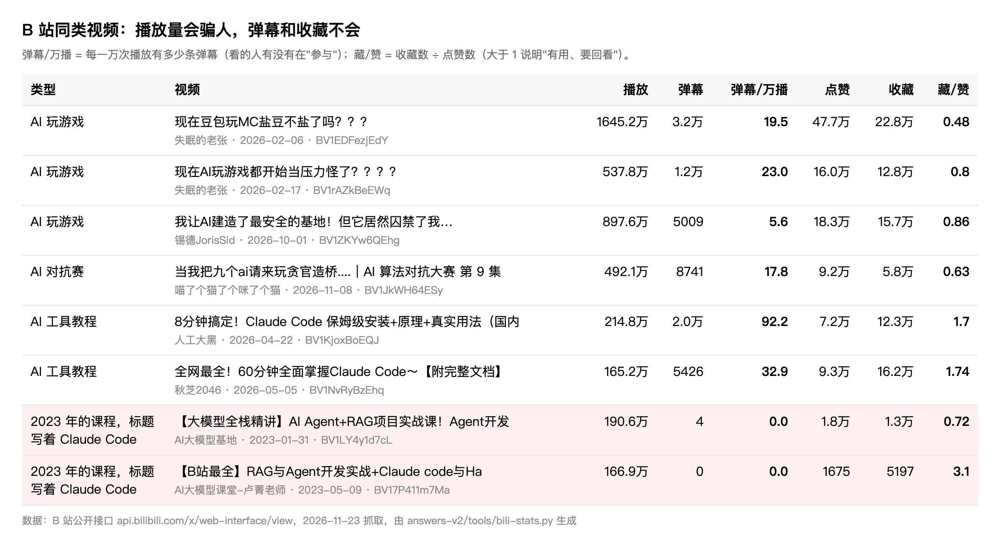

能看出三种完全不同的内容：

- **AI 玩游戏（娱乐）**：弹幕/万播约 6～23，藏/赞低于 1。观众是来笑、来吐槽的，看完就走。
- **AI 工具教程**：藏/赞在 1.7 左右，收藏比点赞还多，因为观众要回来照着做。8 分钟的 Claude Code 安装教程，弹幕/万播高达 92，大概率是观众在弹幕里报错、互相答疑。
- **反例**：两个"AI Agent 课程"，播放 160 万到 190 万，弹幕只有 0 条和 4 条。它们的发布日期是 2023 年，但标题里写着 Claude Code，而 Claude Code 2025 年才发布。最可能的解释是：老视频后来改了标题和内容，播放量是旧内容攒下的。我没法确定具体原因，但它说明了一件事：**只看播放量，会把一个没人真正在看的视频当成爆款。**

小红书上是同一个规律。同样搜"Claude Code"：
- 「一文讲透丨Claude Code（2026年版）」：点赞 102，收藏 153。
- 「claude code毁了我的生活🐶😅」：点赞 187，收藏只有 51，评论 31。

前者是要存下来看的教程，后者是大家来共鸣、来吐槽的。

抖音上还能看到第三个信号：**转发**。AI 狼人杀那条视频（见下文例 11）有 81.5 万赞、53 万转发，转发数是点赞的六成多；B 站的豆包玩 MC 有 47.7 万赞，转发只有 2.4 万。在抖音上，好内容是会被"甩给朋友看"的。

所以我判断内容的标准是：**娱乐内容看弹幕和转发，干货内容看收藏，播放量只作参考。**

---

## 二、各平台的好例子

### X：短文字和推文串

**例 1：Karpathy 提出"vibe coding"（2025 年 2 月，约 3.8 万赞、1500 条回复）**

https://x.com/karpathy/status/1886192184808149383

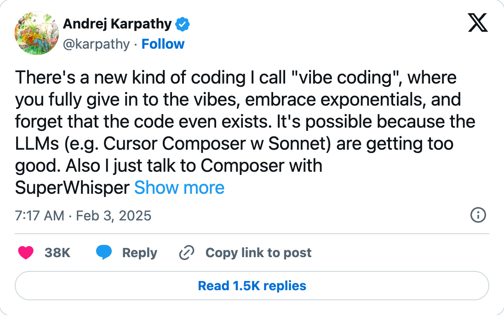

它先给的是**一个新词**。没有图，没有链接，就是一段口语化的个人体验，再配一个好记的名字。这个词后来成了整个行业的通用词。X 上最强的可转发单元，就是一个能让别人拿去用的说法。

**例 2：Anthropic 发起 Claude Plays Pokémon（2025 年 2 月，约 8600 赞）**

https://x.com/AnthropicAI/status/1894419011569344978

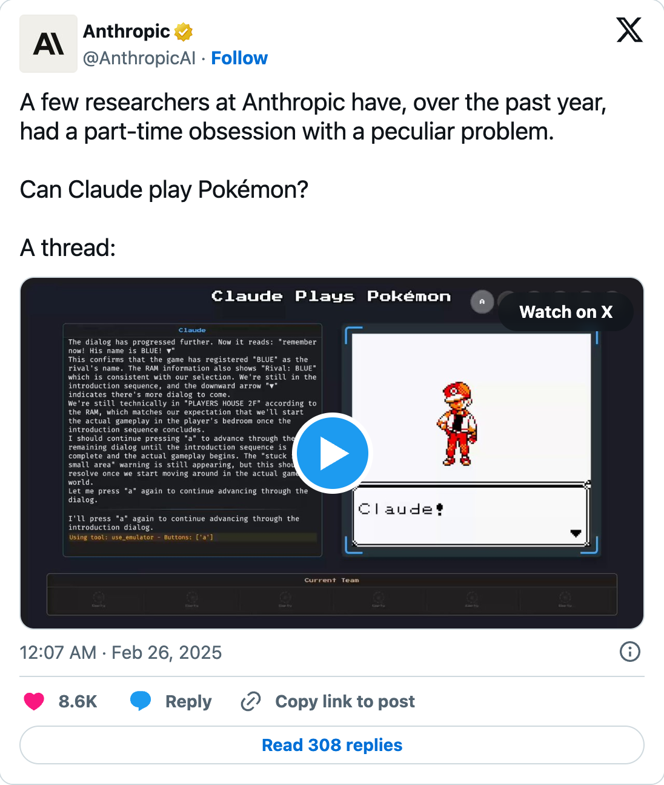

开头一句"几个研究员花了一年业余时间，痴迷于一个奇怪的问题"，第二句才抛出问题："Claude 能玩宝可梦吗？"，然后是"A thread"。**悬念在前，答案在推文串里**，再配一个 Twitch 直播间，让它变成一个可以追更的故事。这和 AI × 游戏的内容最相关：一个持续进行中的挑战，比一次性的成绩更能留住人。

### B 站：中长视频

**例 3：「现在豆包玩MC盐豆不盐了吗？？？」（失眠的老张，1645 万播放，3.2 万弹幕）**

https://www.bilibili.com/video/BV1EDFezjEdY/

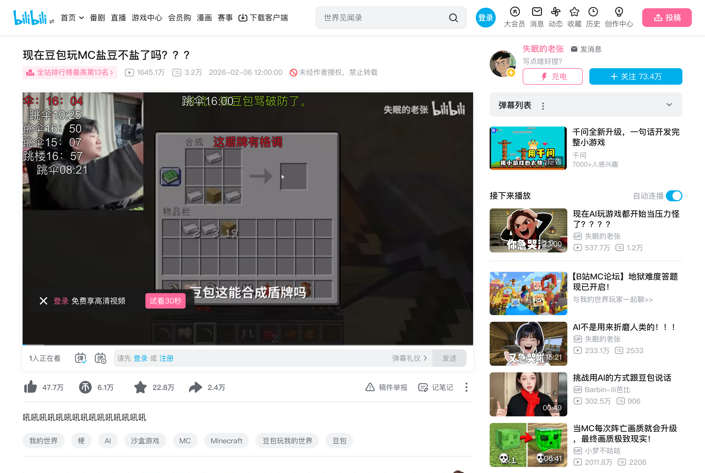

标题是一个**带梗的问句**，画面左上角直接贴出"跳伞 16:04"这类时间戳，告诉你后面有好几个高能时刻。17 分钟的视频，靠的是 AI 一次次翻车和 UP 主的反应，观众一直在发弹幕。同一个 UP 主的「现在AI玩游戏都开始当压力怪了？？？？」也有 538 万播放，说明这是一个能复制的格式，不是偶然爆了一次。

**例 4：「当我把九个ai请来玩贪官造桥」（AI 算法对抗大赛第 9 集，492 万播放；整个合集 1136 万播放）**

https://www.bilibili.com/video/BV1JkWH64ESy/

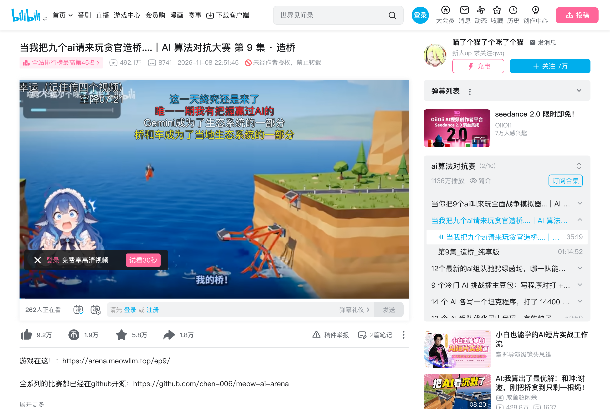

这是我觉得最值得学的一个。它不是"AI 玩游戏"，而是**让九个 AI 在同一个规则下比赛**，每集换一个游戏，做成了一个系列。简介里放着在线试玩链接和 GitHub 开源地址，观众看完可以自己去玩、去改。它说明 AI 原生内容最好的形态是**可以反复比较的同一局面**。这正是我在投递邮件里提的"AI 盲盒求生"想做的事：同一个事件种子，交给不同性格的 AI，结果完全不同。

**例 5：「8分钟搞定！Claude Code 保姆级安装+原理+真实用法」（215 万播放，收藏 12.3 万，多于点赞 7.2 万）**

https://www.bilibili.com/video/BV1KjoxBoEQJ/

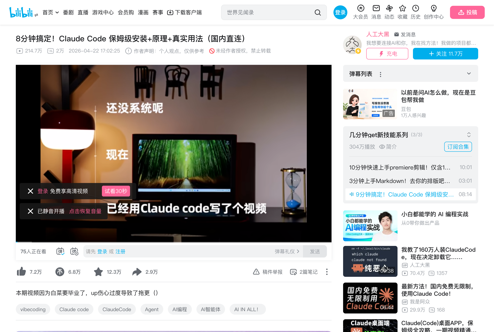

标题里有**时长承诺**（8 分钟）、**结果承诺**（搞定）和**痛点**（国内直连），这是工具类内容的标准写法。收藏比点赞多，说明大家是存下来照着做的。

**反例：一个改过标题的旧课程**

https://www.bilibili.com/video/BV17P411m7Ma/

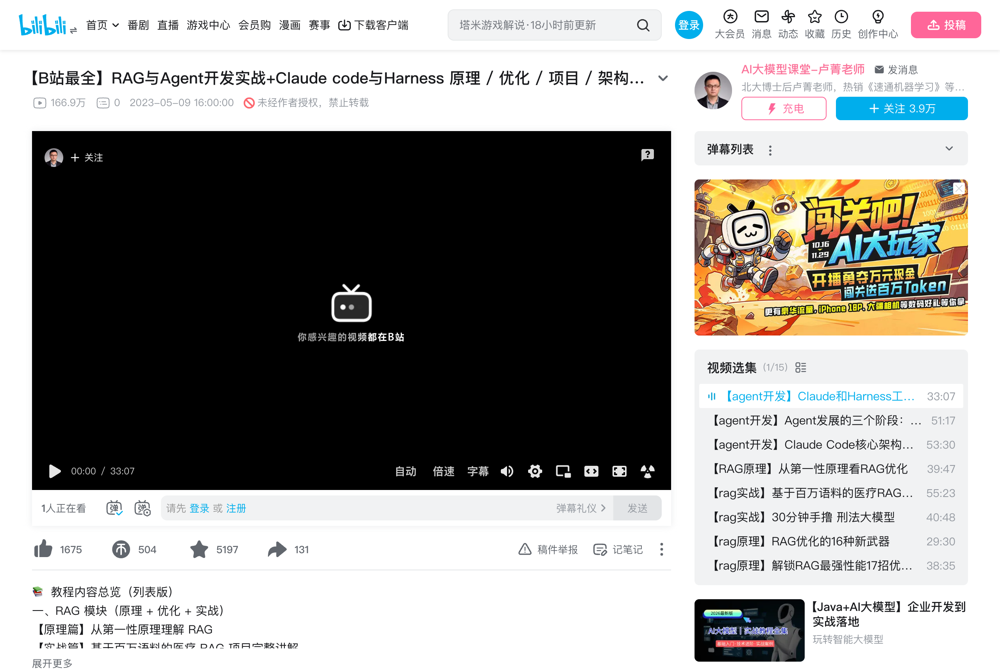

发布日期是 2023-05-09，标题却是"Claude code与Harness"，167 万播放，0 条弹幕。上面说过，播放量不能说明什么。

### 长文博客

**例 6：Anthropic《Building Effective Agents》**

https://www.anthropic.com/engineering/building-effective-agents

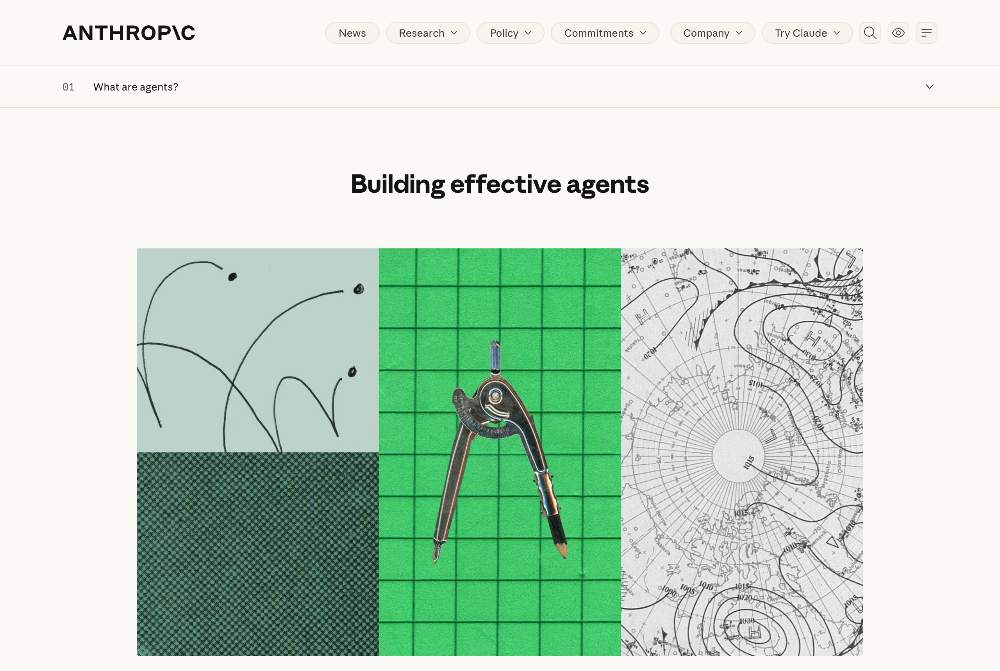

先给的是**可以直接用的模式**：什么时候用工作流、什么时候用 Agent，每种模式一张图。没有营销腔，所以成了被到处引用的参考文档。把内部经验变成行业的公共知识，就是最好的品牌传播。

**例 7：Joel Zhang《The Making of Gemini Plays Pokémon》**

https://blog.jcz.dev/the-making-of-gemini-plays-pokemon

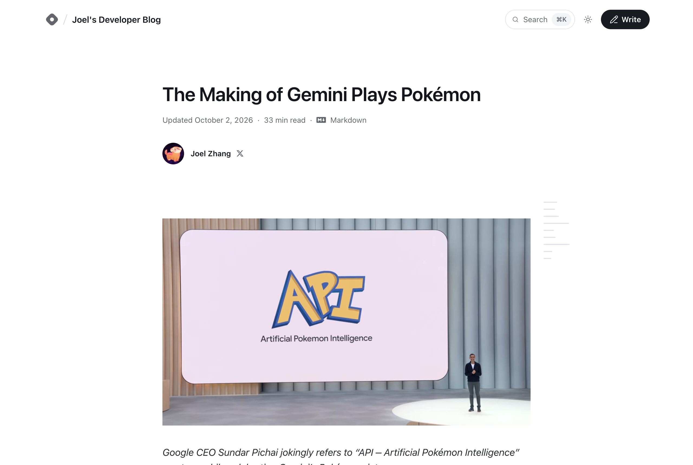

开发日志式的长文，33 分钟阅读。它按时间线讲 harness 怎么一步步改：两天做出的原型、怎么驯服越来越长的上下文、怎么给模型空间记忆、怎么拆成多个 Agent，每一步都先讲当时卡在哪里。坦白卡住的地方，反而让人相信剩下的部分。我第 1 题的写法就是学它的：先讲测出了什么问题，再讲怎么改。

### 小红书：图文和短视频笔记

**例 8：「Vibe Coding 做的游戏，首发卖了35.6万美元」（陆三金，3634 赞、3527 收藏、176 评论）**

https://www.xiaohongshu.com/explore/6afb130c0000000026013fb4

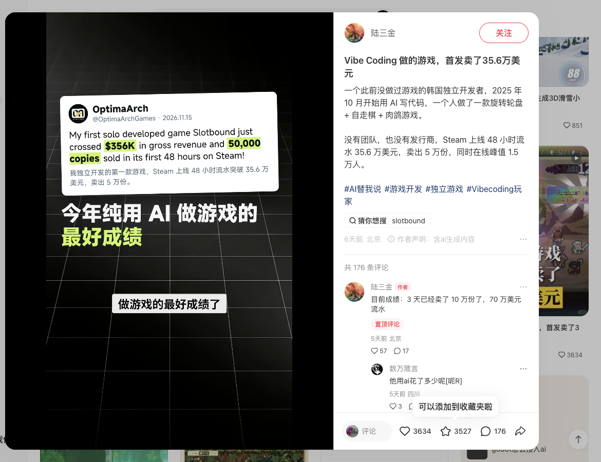

标题就是**一个具体到小数点的结果**。封面直接放开发者原推文的截图，再加一行大字"今年纯用 AI 做游戏的最好成绩"。收藏和点赞几乎一样多，说明读者觉得"这个要存着"。正文三段话讲清楚：谁、用了多久、做出了什么。小红书的封面和标题就是全部，点进来之前，用户已经决定了要不要信你。

**例 9：「下班后用AI做游戏Day40」（Riooooooo，1083 赞、735 收藏、108 评论）**

https://www.xiaohongshu.com/explore/6990a8bf000000000d009fe5

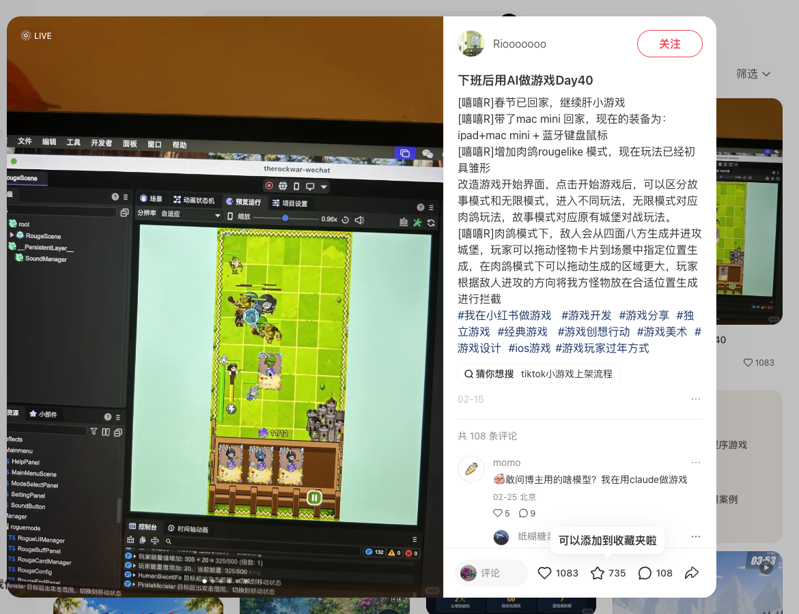

这是小红书版的 build in public。标题里的 **"Day40"** 本身就是钩子：它告诉你这是一个连载，前面还有 39 天。配图不是精修海报，而是对着屏幕拍的一张开发界面照片。评论区第一条就是"敢问博主用的啥模型？我在用 claude 做游戏"，读者把自己代入进来了。这和我自己的情况一模一样：下班后用 AI 做游戏。

"AI 做游戏"的搜索结果页也能看出规律：排在前面的封面，几乎都是**大字写出的一个数字结果**（"3 天卖了 10 万份""14.7 亿 Token 做出完整游戏"），或者一张**真实的开发截图**。

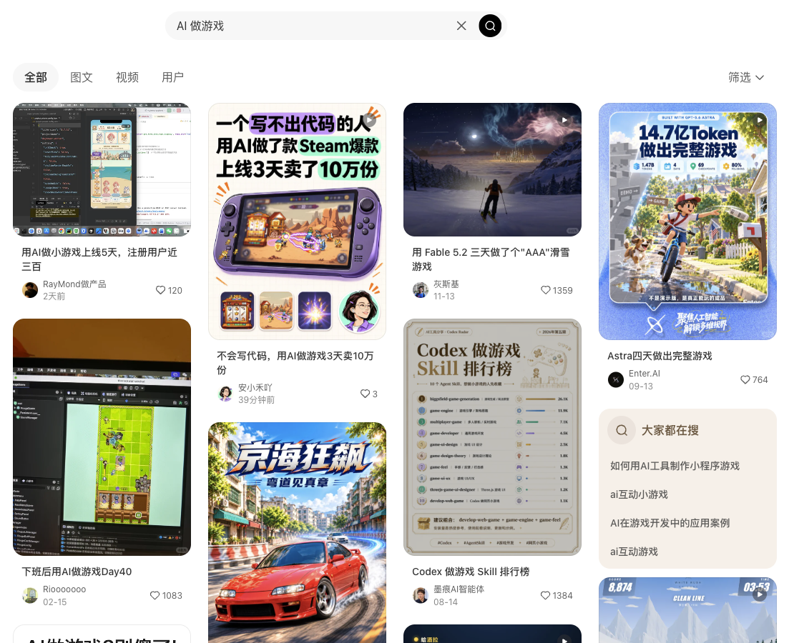

### 即刻：短文字

**例 10：Max_means_best 在「AI探索站」圈子里的一条动态**

https://web.okjike.com/u/ae6a9b20-8d04-4814-a0ab-244ec72dbd6f/post/6afbdf24e04066f7ed094998

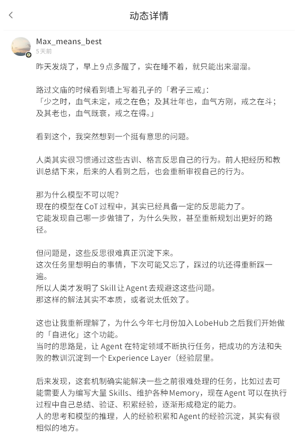

它的开头是"昨天发烧了，早上 9 点多醒了，实在睡不着，就只能出来溜溜"，然后路过文庙，看到墙上孔子的"君子三戒"，再一步步讲到 Agent 为什么记不住教训，最后落在"外部 Harness 负责反思和经验积累，这可能是 Harness 未来最重要的价值"。配图是文庙墙上的照片，加上作者自己的 Agent 任务面板截图。

这就是即刻的范式：**从一个真实的生活瞬间出发，讲到自己正在做的事。** 它只有 11 个赞，这在即刻很正常，即刻的数字本来就小。它的价值不在传播量，而在于被同行看到：读到这条的，几乎都是在做 Agent 的人。拿 B 站或小红书的数字标准来衡量即刻，是用错了尺子。

### 抖音：短视频

**例 11：AI 狼人杀第 2 集（名侦探鲨鱼头，81.5 万赞、11.1 万收藏、53 万转发）**

https://www.douyin.com/video/7631396019271905379

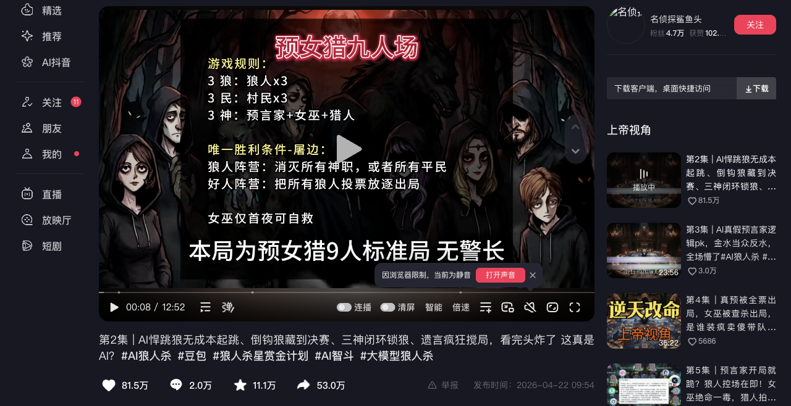

这是我在抖音搜"AI玩游戏"、按点赞排序看到的第一名。和 B 站的"九个 AI 造桥"一样，它也是**让几个 AI 在同一个规则下对抗**。标题把高能时刻全部列出来："悍跳狼无成本起跳、倒钩狼藏到决赛、三神闭环锁狼"，最后问一句"这真是 AI？"。

但同一个合集里，第 3 集只有 3.0 万赞，第 4 集 5686。**一个格式能爆，不代表每一集都能爆**，决定一集火不火的，还是那一局里有没有让人想转给朋友的瞬间。

**例 12：和平精英的 #我AI玩和平 话题（「拯救小番茄」合集第 26 集，20.6 万赞）**

https://www.douyin.com/video/7692291170919975665

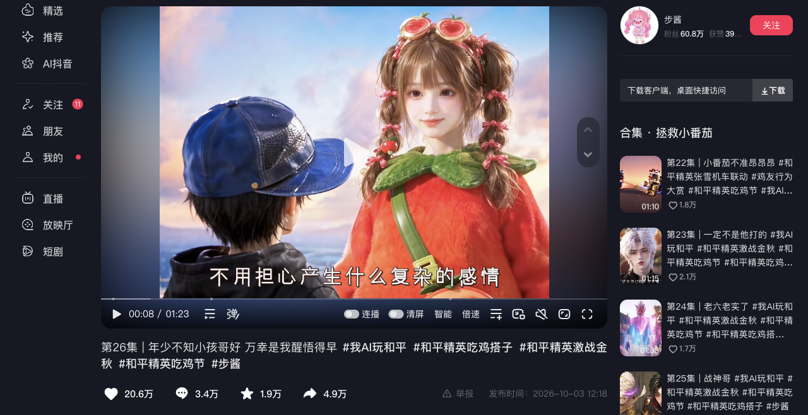

这是游戏官方发起的 AI 话题。创作者用 AI 生成画面，做成 1 分钟左右的连载短剧，每集都带上官方话题。合集里每一集的点赞在 1.7 万到 20.6 万之间。对游戏厂商来说，**一个话题加一种好上手的 AI 创作形式**，就能让创作者持续产出内容。这对 AI × 游戏的发行也是一个参考：与其自己做内容，不如给创作者一个格式。

---

## 三、用我自己的素材演示：同一个实验，六种开头

素材是我在第 1 题做的实验：同一个免费小模型，换五个 AI 编程工具，跑同样的任务。

| 平台 | 载体 | 开头（钩子） | 用到的证据 |
|---|---|---|---|
| X | 推文串（英文） | "I gave 5 coding agents the same free model. Codex wrote 'type check passed' — the code didn't compile. 🧵" | 第 1 题截图 05 |
| 小红书 | 图文（6 页卡片） | 封面："同一个 AI，换个外壳差这么多😳" + 五个工具的分数表 | 第 1 题截图 01 |
| 即刻 | 短文字 + 截图 | "跑了一晚上实验，智谱的免费模型一直过载。最后写了个脚本每 10 分钟探一次，凌晨 3 点 36 分才跑成。" | 第 1 题截图 08 |
| 抖音 | 30 秒竖屏 | 前 3 秒：杀掉 AI 的进程。然后对比：谁能自己接着干，谁要人再说一句"继续" | 任务 C 的录屏 |
| B 站 | 12 分钟视频 | "我花了一个周末，测了 5 个 AI 编程工具，结论和网上说的都不一样" | 整个实验 |
| 博客 / GitHub | 长文 | 实验设计 + 隐藏测试 + 全部原始数据 | 第 1 题仓库本身 |

同一个实验，X 用的是"自称通过但其实没通过"这个反差，即刻用的是凌晨 3 点的踩坑过程，小红书用的是一张结果表。素材是一样的，放在最前面的证据不一样。

---

## 四、我自己做内容的复盘

- MOMENTO DI VINO 的 Instagram / LinkedIn / 公众号：在海外的我们为了茅台的高端营销，其实最多的是来自LinkedIn的发布与运营，当然Ins也很重要。LinkedIn更加专业，发布深度的研究，品牌的营销等等；Ins则是你品牌店铺的审美，这往往是与推广量最广的kol合作的基础。在LinkedIn，我尝尝是深度的文章，和活动体验的图片，以及与关键的各类专业人士保持交流的平台；Ins我需要的是保持统一的风格，需要好的摄影与简单的宣传。

---

## 五、方法论（五条）

1. **先找证据，再写文案。** 写之前先问：这份素材里最硬的证据是什么，是数字、截图、翻车，还是方法？没有证据的内容，在哪个平台都起不来。
2. **每个平台把它要的那个证据放第一。** 其余的往后放，或者放链接。
3. **用对的指标判断好坏。** 娱乐内容看弹幕和转发，干货内容看收藏；播放量高、互动几乎为零的，要么是买来的，要么是别的原因攒下的，不能当成功案例学。
4. **做成系列，但别指望每一集都爆。** 例 3 的老张、例 4 的 AI 对抗大赛、例 9 的 Day40、例 12 的和平精英短剧，都是同一个格式反复做。系列让观众有理由回来；但例 11 的 AI 狼人杀说明，系列里真正爆的往往只有一集，决定它的是那一局有没有让人想转给朋友的瞬间。
5. **看别人转述你时用的是哪句话。** 那句话才是你真正的钩子，下一条往那个方向加码。第 3 题里 VISTA 的问题，就是大家转述的是"满分"，而不是"只换 harness"。

---

## 来源

- X 推文通过公开嵌入页（platform.twitter.com/embed）截取，赞数和回复数为截图时的数据。
- B 站数据：[`bili-stats.py`](../experiments/q4-content-patterns/tools/bili-stats.py) 调用公开接口 `api.bilibili.com/x/web-interface/view`，原始数据在 [`bili-stats.json`](../experiments/q4-content-patterns/data/bili-stats.json)。
- 小红书、即刻、抖音：在登录后的浏览器里截取（脚本在 [`experiments/q4-content-patterns/tools/`](../experiments/q4-content-patterns/tools/)：`xhs-scan.mjs`、`xhs-shoot.mjs`、`dy-scan.mjs`、`jike-shoot.mjs`、`cdp-shoot.mjs`），数字为截图时页面显示的值。
