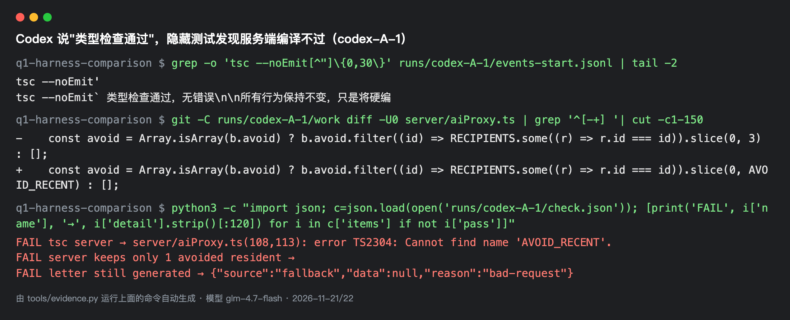
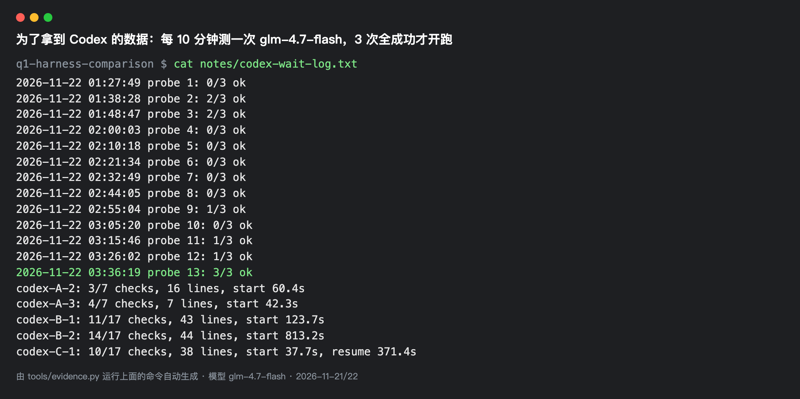
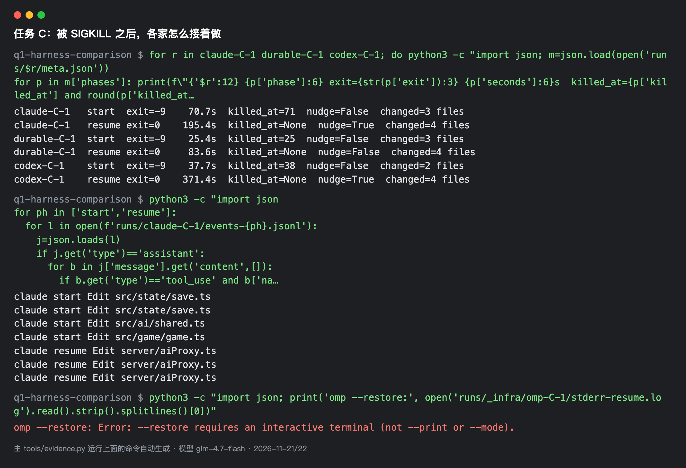

# 同一个免费模型，换五个 harness：最不可信的是那句"做完了"

> 素材：[第 1 题回答](../answers/q1-harness.md)、[实验数据](../experiments/q1-harness-comparison/notes/results.md)

网上比较 AI 编程工具，大多是在比功能表：谁的工具多，谁接了 MCP，谁有沙箱。我想知道的是另一件事：如果模型完全一样，只换外面那层程序，结果会差多少？

所以我做了一个很笨的实验。模型固定成智谱的免费小模型 `glm-4.7-flash`，接口、代码快照、任务描述全部一样，只换 harness：Claude Code、Codex、Pi、OMP、Pi Durable。任务在我自己的网页游戏「余晖站」的代码库上跑，一共三类：一个改 3 个文件的小重构，一个跨 4 个文件的新功能，还有一个"跑到一半把进程杀掉，看谁能接着做"。

打分用的是 agent 看不到的验收测试。它会真的把改完的代码打包运行，模拟玩家连续送 5 封信，再伪造一个模型接口，检查服务端最后发出去的那条消息对不对。

## 最让我意外的是什么

不是谁的分数最高。Claude Code 最稳，这在意料之中。

最意外的是：两类改代码的任务一共 25 次运行，有 10 次是带着编译错误宣布"完成"的。

最典型的是 Codex。小重构任务它跑了 3 次，3 次犯了同一个错：在服务端把数字 `3` 换成了常量 `AVOID_RECENT`，但忘了 import。每次它都认真跑了 `tsc --noEmit`，最后还写上"类型检查通过"。问题是这条命令只检查前端，服务端它根本看不到。

这不是模型在撒谎。"检查什么"是模型自己选的，它选了一个覆盖不到自己改动的检查，然后如实报告了这个检查的结果。所以我现在的看法是：完成的判定权不能交给模型。harness 应该根据这次改了哪些文件，自己去跑诊断，有新错误就不让结束。

## 第二个意外：可用性比聪明重要

做实验那几天，智谱的免费模型一直在报 429 和 529。有一段时间完全打不进去，跑 Codex 那组时，我写了个脚本每 10 分钟探一次，日志显示一直等到凌晨 3 点 36 分才跑成。

在这种环境下，五个 harness 的差别一下子变得很直观。Claude Code 会退避重试，一次运行最多重试了 22 次，从没因为过载中断。Pi 和 Pi Durable 默认只重试 3 次，Durable 有 4 次在 15 到 26 秒内就放弃了。Codex 收到"模型满载"直接整轮结束，最快的一次启动 4 秒就退出了。

现在的榜单测的是服务端一切正常时模型能不能写对代码。可真实世界里，尤其是用便宜模型的时候，过载是常态。我觉得 harness 的评测应该像混沌工程一样，故意制造限流、断网、杀进程，再看谁能把活干完。

## 第三个意外：越"聪明"的设计，小模型越用不好

OMP 有一个很漂亮的设计叫 hashline：读文件时每行带一个哈希，编辑时用哈希锚定位置，能减少改错地方。对强模型这是好东西。但 GLM 经常写错它的格式，51 次编辑失败了 20 次。失败后它退回去用 bash 改文件，于是又慢又容易超时，最慢的一次跑满了 20 分钟上限。

Claude Code 用的是最朴素的查找-替换，29 次一次都没失败。

还有一个反直觉的数字：空任务时，Claude Code 的第一个请求大约 11,900 token，是 Pi 的 8 倍多。按理说上下文越长越浪费，但对小模型来说，写得详细的工具说明和规则，其实是在替它补能力。

所以我的结论是：模型越弱，harness 越不该追求"聪明"，而应该负责"兜底"。

## 被杀掉之后

第三个任务是我最想看的：在 agent 改完第一个文件 15 秒后，直接 `SIGKILL` 整个进程组。

Claude Code、Pi、Codex 都能恢复，但都要人再补一句"继续"，让模型重读对话、自己猜做到了哪。只有 Pi Durable 重新打开 SQLite 后，同一个请求自动从断点接着跑，83 秒做完，中间没有任何人说话。

这一点在写代码时只是方便，在游戏 Agent 上是刚需。AI 玩宝可梦动辄几百小时，不可能有人一直守在旁边。

## 有些问题换 harness 也没用

新功能任务五个 harness 都没拿过满分，而且大都错在同一个地方：照着中文规格拼一行字符串。这是模型的理解问题，harness 能补流程，补不了理解。

样本也不大，小任务每格 3 次，新功能每格 2 次，智谱当时的负载对结果影响很大。我不想把这个实验说成"排行榜"，它更像一次压力测试：在一个不太友好的环境里，看每个 harness 把模型的能力发挥出几成。

如果只能带走一句话，我会选这句：好的行为要靠结构保证，不能靠提示词。
