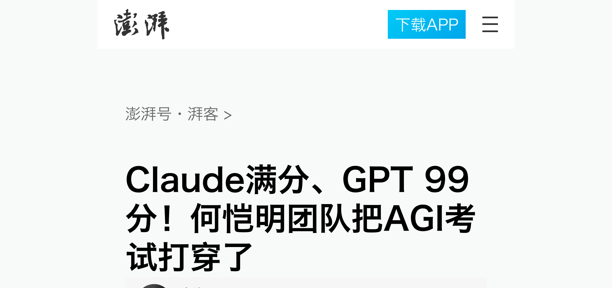
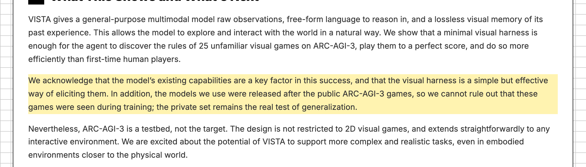
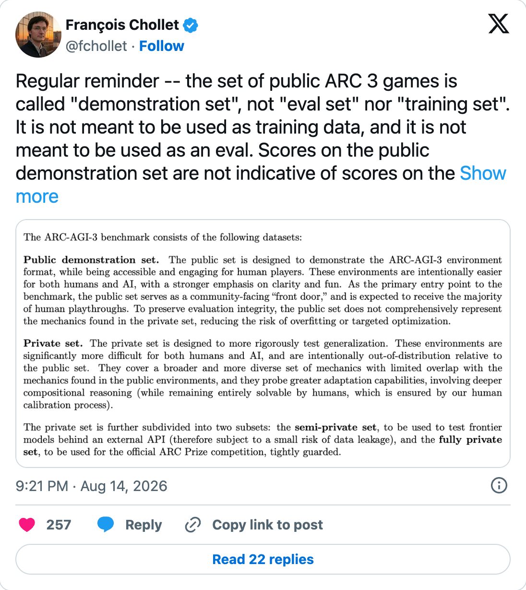

# VISTA 的"满分"，是它最响亮的一句话，也是最大的风险

> 素材：[第 3 题回答](../answers/q3-vista-launch.md)

VISTA 的项目主页第一屏写着：25 个公开游戏全部满分。中文媒体的标题更进一步，说它"把 AGI 考试打穿了"。

同一个主页的最后一节，作者自己写了一段限定：所用模型发布于公开游戏之后，不能排除训练时见过这些游戏，私有集才是真正的泛化检验。

第一屏有人抄，最后一节没人看。

## 基准作者的提醒

8 月 14 日，ARC-AGI 的作者 Chollet 发了一条"例行提醒"，大意是公开游戏是演示集，不是评测集，它上面的分数不代表真实成绩。这条推文没有点名任何人，但它发在 VISTA 博客发布后的第 9 天。我没法确认它针对谁。

这不影响 VISTA 是一篇扎实的研究。但只要私有集的成绩不是满分，第二波传播就可能变成"满分被打脸"。

## 换一句主信息

如果我负责传播，我会主动降调，把"满分"换成：同一个模型，不训练，只换一个会"看"的 harness，ARC-AGI-3 从 40 分到 100 分。

这句话保留了反差，又把功劳放在 VISTA 真正的贡献上。更重要的是，即使私有集分数低一些，它也站得住，因为"只换 harness 涨了多少"在私有集上可以重新测。

我偏爱这句，还因为我自己做过类似的实验：固定模型，只换 harness。差距确实在那里。

## 把限定提前

我会把末尾那段限定挪到第一屏，单独发一条：我们哪些没测，私有集打算怎么测。

这个判断来自我自己的经历。我在苏黎世学联做宣传，每年 40 多场活动。让人来参与，最直接的办法往往是给补贴，但这种参与是一次性的，数字好看，人留不住。真正带着目的来的人，最想听到的是真诚的回答。

VISTA 也一样。追着"满分"来的读者，私有集一出就走；被"只换 harness"和"我们还没证明什么"吸引来的研究员和工程师，才会去复现、去移植。

## 最被低估的素材

主页给每个游戏都放了完整回放，能看到模型每一步看了什么、记了什么、回看了哪一帧。但它们埋在页面中段，只是一个"View replay"链接。

B 站上"AI 玩游戏"的视频有几百万上千万播放，观众要看的就是这个：卡住、回看、突然想通。我会挑 3 个最有戏剧性的，剪成 30 秒竖屏和 3 分钟横屏。

## 怎么算成功

我不看阅读量，看三件事：有多少人在移植和复现；别人转述时用的是"满分"还是"只换 harness"；私有集结果出来那周，舆论是"果然不行"，还是"他们早就说过"。

最后一件最难，也最能说明问题。
