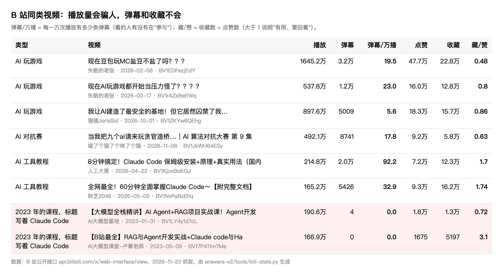

# 播放量会骗人：看了六个平台的 AI 内容之后

> 素材：[第 4 题回答](../answers/q4-content-patterns.md)、[B 站原始数据](../experiments/q4-content-patterns/data/bili-stats.json)。数字是截图时的值，会变。

我在 B 站翻 AI Agent 课程时，看到两个播放量 160 万到 190 万的视频，弹幕分别是 0 条和 4 条。

它们发布于 2023 年，标题里却写着 Claude Code，而 Claude Code 2025 年才发布。最可能的解释是老视频改了标题，播放量是旧内容攒下的。我没法确定具体原因，但如果只按播放量找学习对象，这两个会排在很前面。

## 两个比值

所以我拉了 8 个同类视频的公开数据，看两个比值：每一万次播放有多少条弹幕，以及收藏除以点赞。

AI 玩游戏的视频，弹幕每万播大约 6 到 23，收藏比点赞少，大家来笑、来吐槽。AI 工具教程的收藏是点赞的 1.7 倍左右，大家要回来照着做。一条 8 分钟的 Claude Code 安装教程，弹幕每万播高达 92，我猜是观众在弹幕里报错和互相答疑。

小红书上同样成立。都是搜"Claude Code"，「一文讲透」102 赞、153 收藏；「毁了我的生活」187 赞、51 收藏。前一篇是拿来存的，后一篇是拿来共鸣的。

抖音多一个信号。有一条 AI 狼人杀 81.5 万赞、53 万转发，转发是点赞的六成多；B 站的豆包玩 MC 47.7 万赞，转发 2.4 万。

所以我的标准是：娱乐内容看弹幕和转发，干货看收藏，播放量只作参考。样本很小，这是一个好用的经验，不是规律。

## 同一个系列，也不会每集都火

那个 AI 狼人杀的合集，第 2 集 81.5 万赞，第 3 集 3.0 万，第 4 集 5686。

做成系列仍然值得，它让人有理由回来。但格式只是入场券，决定一集火不火的，是那一局里有没有让人想转给朋友的瞬间。

## 每个平台停下来的理由不同

看完一圈例子，我觉得"一鱼多吃"不是把一段话改写六遍，而是从同一份素材里，给每个平台挑出它要的那个证据放在最前面。

X 要一个观点或者新词，Karpathy 的 vibe coding 没有图也没有链接。小红书要一张能看懂结果的图，比如"首发卖了 35.6 万美元"。即刻要一个真实的瞬间，我看到一条从发烧出门、路过文庙写起，最后讲到 harness 的动态，只有 11 个赞，但读到的大多是同行。抖音要一个瞬间，B 站要整个过程，长文博客要一套能复现的方法。

拿我自己的 harness 实验举例，X 上我会先放"Codex 写了类型检查通过，但代码编译不过"；即刻先放凌晨 3 点 36 分才跑成的日志；小红书先放五个工具的分数表。实验只有一个，开头有六种。

## 看别人怎么转述你

最后一条经验来自 VISTA。它真正的贡献是"只换 harness"，可大家转述的是"满分"。

别人转述你时用的那句话，才是你真正的钩子。如果它不是你想要的那句，下一条就该改了。
